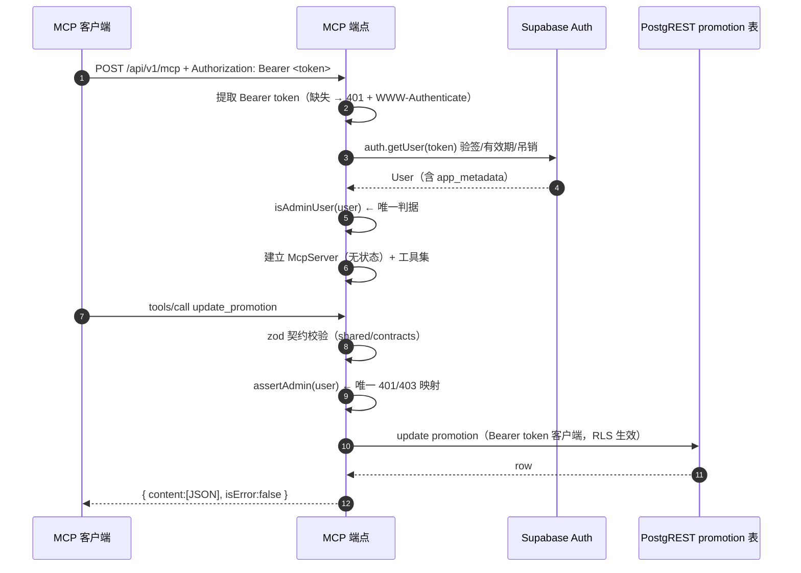

# MCP 技术方案定稿：工具面 / 鉴权模型 / 模板复用边界

> 状态：**已定稿**（产品决策已确认 2026-10-24，见 §0.1）
> 关联 issue：LEOK-14（总纲）· LEOK-16（本方案）
> 参照实现：`ipa-changelog` 的 IPA-80（工具面）/ IPA-86（一切以模板为准）
> 核实基线：`@nuxt-tmpl/nuxt@0.2.11` 与 `@nuxt-tmpl/core@0.2.11`（npm 发布产物已核对）、本仓库 MCP 分支
> 性质：**方案文档，不含业务实现代码**。阶段 2/3 按本文落点实现。

---

## 0. 结论摘要

| # | 议题 | 定稿结论 |
|---|---|---|
| **D1** | 工具面 | 6 个工具：`list_promotions` / `get_promotion` / `create_promotion` / `update_promotion` / `delete_promotion` / `set_promotion_active` |
| **D2** | 读工具是否鉴权 | **端点统一要求 Bearer**（Supabase OAuth access token）。读工具对**任意已认证用户**开放；写工具要求 **admin**。读权限在**工具级**表达，不在端点级分叉 |
| **D3** | 管理员判定 | **单一真源**：`isAdminUser(user)` ≡ `user?.app_metadata?.role === "admin"`（全仓唯一出现处）。会话 cookie 与 Bearer token 只是"身份获取方式"不同，判定逻辑与 401/403 映射完全共用 |
| **D4** | 契约层 | **引入** `shared/contracts/promotion.ts`（zod v4）为唯一真源。`parsePromotionForm*` 改为委托该契约，HTTP API 与 MCP 工具入参同源 |
| **D5** | 端点与传输 | `POST /api/v1/mcp`，Streamable HTTP **无状态**（`sessionIdGenerator: undefined` + `enableJsonResponse: true`），`GET`/`DELETE` 返回 405 |
| **D6** | 模板复用边界 | **不自建**发现元数据路由、**不自建** `/oauth/consent` 页面、**不自研** OAuth/AS。默认语言的 `/.well-known` 与 `/oauth/consent` 使用 core 内置豁免；i18n 英文 consent 需精确加入 `publicRoutes`。MCP 仅放行 `/api/v1/mcp`，不放行整个 `/api/v1` |
| **D7** | 机器凭据 | **不做** App Token / machine credential 体系（本项目只有 Supabase 用户身份，复制 ipa-changelog 的机器写入是另一个产品特性） |
| **D8** | 数据访问 | 走**调用者 token** 的 Supabase 客户端（模板自带的 `createTokenSupabaseClient`），不经 HTTP 自调用；应用层可见性规则为权威，RLS 为纵深防御 |
| **D9** | RLS | **约定启用**（产品决策 2026-10-24）。`promotion` 表启用 RLS，策略见 §3.5；应用层判定**不因此放松**，两者是"DB 层 + 应用层"双闸 |

### 0.1 产品决策确认（2026-10-24）

| # | 产品决策 | 对方案的影响 |
|---|---|---|
| 1 | **Supabase 约定启用 RLS** | 采纳为项目约定。§3.5 补齐 `promotion` 表的策略规格；§7 的 R1 由"RLS 未开启的越权面"改写为"策略未落地/漂移"；**应用层的 `assertAdmin` 仍保留为权威判定**，不因有 RLS 就放松 |
| 2 | **契约严格些好** | 确认 §4.3 的 B1–B8 行为收紧清单**全部采纳**。`parsePromotionForm*` 改为严格 zod 契约，不再保留"静默兜底"语义 |
| 3 | **读取也要在 OAuth 授权后** | 确认 D1：**端点统一要求 Bearer**，读工具亦需 OAuth 授权。§3.1 的"端点匿名读"备选方案正式**否决**，不再保留实现分支 |

---

## 1. 已核实事实

### 1.1 模板复用面（`@nuxt-tmpl/nuxt@0.2.11`，发布产物已核对）

| 能力 | 产物 | 结论 |
|---|---|---|
| RFC 9728 发现元数据 | `runtime/server/handlers/oauth-protected-resource.js` | 注册 `/.well-known/oauth-protected-resource` 与 `/.well-known/oauth-protected-resource/**`；0.2.11 起不依赖 auth provider |
| OAuth 同意页 | `runtime/pages/oauth/consent.vue` + `runtime/components/oauth/DefaultOAuthConsent.vue` | provider = `supabase` 且项目未自建同名页时自动注册；UI 可用 `useAuthForms({ OAuthConsentForm })` 替换 |
| Bearer 客户端 | `runtime/server/utils/supabase.js` → `createTokenSupabaseClient(token)` | 模板已提供，MCP 鉴权与数据访问直接复用 |
| 响应解包 | `runtime/server/utils/api-response.js` → `skipResponseWrap(event)` | 模板已提供，用于绕过 `apiResponse` 插件的信封包裹 |
| 路由豁免清单 | `@nuxt-tmpl/core@0.2.11` → `isSafeRoute()` | 内置豁免 `["/__nuxt_error", "/oauth/consent", "/.well-known", "/authorize", "/token"]` |

### 1.2 本次复核对既有侦察结论的**修正**（重要）

《mcp-recon.md》与父 issue 的"关键前置事实 3"写的是"**MCP 端点与发现元数据路径都必须加进 `nuxtTmpl.auth.publicRoutes`**"。逐行核对 `@nuxt-tmpl/core@0.2.11` 后，结论需要修正：

1. **默认语言的 `/.well-known` 与 `/oauth/consent` 无需显式放行**。core 的 `isSafeRoute(path, guestRoutes, publicRoutes)` 内部恒定并入原始路径的内置豁免清单；它不会去除 i18n locale 前缀。MCP 端点需单独配置在 `publicRoutes`，且路径前缀应限定为 `/api/v1/mcp`，避免同级 API 跳过全局鉴权；英文 consent 需精确别名 `re:^/en/oauth/consent/?$`。
   → `guestRoutes` 为英文首页、登录、注册和 dashboard 补齐与默认路径等价的别名；英文首页使用锚定正则 `re:^/en/?$`，避免放行 `/en` 下其他路径。
2. **`nuxtTmpl.mcp.enabled` 的默认值是 `false`**（`module.mjs` 的 `defaults` 里 `mcp: { enabled: false }`，注册条件是 `options.mcp?.enabled !== false`）。
   → 必须显式写 `mcp: { enabled: true }`，否则发现元数据**根本不会出现**。
3. **core 必须与 nuxt 同版本升级**。豁免清单在 **core** 里；当前项目将两者固定为 `0.2.11`，避免 runtime 与 core 行为错配。
   → 版本升级必须同时覆盖 `@nuxt-tmpl/nuxt` 与 `@nuxt-tmpl/core`；workspace override 也必须保持一致。
4. **发现元数据的 `resource` 由请求路径后缀决定**。模板 handler：`suffix = pathname.replace(/^\/\.well-known\/oauth-protected-resource/, "")`，`resource = origin + (suffix || "/")`。
   → 客户端应请求 `/.well-known/oauth-protected-resource/api/v1/mcp`，才能拿到 `resource = <origin>/api/v1/mcp`（与实际端点对齐）。请求不带后缀会拿到 `resource = <origin>/`，**指向错误**。
5. **模板的 auth guard 用的是 `user_metadata.role`**（`runtime/server/guards/supabase.js`），客户端可改、不可用于鉴权。本项目继续以 `app_metadata.role` 为准，**两者不可混用**。
6. **模板的 api 错误处理器会把 `/api/*` 的异常包成 `{code,data,message}` 信封**（`runtime/server/handlers/api-error-handler.js`）。
   → MCP 端点的错误**一律「返回 Response」而不是 `throw`**，避免被包成 API 信封而丢失 OAuth 语义。

### 1.3 本项目业务模型（复核确认）

| 事实 | 证据 |
|---|---|
| 表 `promotion` 字段：`name / description / url / category / rebate / invite_code / cover_url / sort / is_active / created_at / updated_at` | `shared/types/promotion.ts` |
| 分类枚举 `llm \| vpn \| other` | `PROMOTION_CATEGORY_ORDER` |
| **站内读公开**：`useSupabaseClient().from("promotion").select("*").eq("is_active", true)`（匿名） | `app/pages/index.vue` |
| **站内写是管理员专属**：`requireAdminSession()` → `app_metadata.role === "admin"` | `server/utils/promotion-admin.ts` |
| 现有校验真源：`parsePromotionForm()` / `parsePromotionFormPartial()`（手写、**宽松兜底**语义） | `server/utils/promotion-form.ts` |
| 现有行映射：`mapPromotionRow()`（snake_case → camelCase 领域对象） | `shared/types/promotion.ts` |
| HTTP `DELETE /api/promotion/:id` 实为**软删**（`is_active = false`），不物理删除 | `server/api/promotion/[id].delete.ts` |
| 前端表单实际提交：`rebate`/`inviteCode` 传 `""`、`coverUrl` 传 `null` | `app/pages/dashboard/index.vue` |
| URL 展示时才补协议（`toAbsoluteUrl`），**落库时不补** | `shared/utils/url.ts` |
| **RLS：产品约定启用**（2026-10-24），`promotion` 表策略见 §3.5 | 产品决策 |

---

## 2. 工具面清单

### 2.1 工具总表

| 工具名 | 标题 | 权限 | 入参 | 返回 | 对应 HTTP 接口 |
|---|---|---|---|---|---|
| `list_promotions` | 列出推广链接 | 任意已认证用户 | `category?`、`includeInactive?`、`page?`、`limit?` | `{ items, page, limit, total, totalPages }` | `GET /api/promotion`（现仅 admin 可用，MCP 放宽为任意已认证用户） |
| `get_promotion` | 读取推广链接 | 任意已认证用户 | `id` | `{ promotion }` | `GET /api/promotion/:id`（不存在） |
| `create_promotion` | 创建推广链接 | **admin** | `name`、`url` + 7 个可选字段 | `{ promotion }` | `POST /api/promotion` |
| `update_promotion` | 更新推广链接 | **admin** | `id` + 9 个可选字段 | `{ promotion }` | `PATCH /api/promotion/:id` |
| `delete_promotion` | 下架推广链接（软删） | **admin** | `id` | `{ id, isActive: false }` | `DELETE /api/promotion/:id` |
| `set_promotion_active` | 启用 / 停用推广链接 | **admin** | `id`、`isActive` | `{ promotion }` | 无（新增细粒度开关） |

**设计说明**

- **命名**：`snake_case`，与参照项目（`list_apps` / `draft_release`）及 MCP 生态惯例一致。
- **不设物理删除**：`delete_promotion` 语义 = HTTP `DELETE` 的软删（`is_active = false`），保证 MCP 与 HTTP 语义**一字不差**；`set_promotion_active` 承担显式启停（含恢复上架）。
- **不设封面上传工具**：`POST /api/promotion/cover` 是 multipart 文件上传，MCP 工具不适合承载二进制，留给 HTTP API。
- **工具清单对所有已认证用户一致**：不做"按身份裁剪 tools/list"。工具名不是敏感信息，权限在**调用时**判定，避免客户端因工具集随身份变化而误判。
- **服务端 `instructions`** 需写明：读=任意已认证用户；写=需要 `app_metadata.role === "admin"`。

### 2.2 入参 schema（逐字段定稿）

#### `list_promotions`

| 字段 | 类型 | 必填 | 默认 | 边界 / 语义 |
|---|---|---|---|---|
| `category` | `"llm" \| "vpn" \| "other"` | 否 | 不筛选 | 枚举，非法值 → 400 |
| `includeInactive` | `boolean` | 否 | `false` | 仅 admin 可为 `true`；非 admin 传 `true` → **403**（明确报错，不静默忽略） |
| `page` | `integer` | 否 | `1` | `1 ≤ page ≤ 10000` |
| `limit` | `integer` | 否 | `20` | `1 ≤ limit ≤ 50`（**分页上限 50**，与参照项目一致） |

排序：`sort DESC, created_at DESC`（与 `app/pages/index.vue` 及 `GET /api/promotion` 一致）。
可见性：非 admin **强制**附加 `is_active = true`；admin 在 `includeInactive=false` 时同样只返回 `is_active = true`。

#### `get_promotion`

| 字段 | 类型 | 必填 | 默认 | 边界 / 语义 |
|---|---|---|---|---|
| `id` | `string` | 是 | — | `1 ≤ len ≤ 64`。⚠️ **待确认**：promotion 表 id 的真实类型（uuid / bigint / text）。若为 uuid，收紧为 `z.uuid()`（zod v4） |

可见性：非 admin 读取 `is_active = false` 的行 → **404**（不返回 403，避免泄露"存在但下架"的信息）。

#### `create_promotion` / `update_promotion` 字段表

| 字段 | 类型 | create 默认 | update | 边界 / 归一化 |
|---|---|---|---|---|
| `name` | `string` | 必填 | 可选 | trim 后 `1 ≤ len ≤ 120` |
| `url` | `string` | 必填 | 可选 | trim 后 `1 ≤ len ≤ 2048`；**归一化后必须是 http(s) 绝对地址**（见 §4.4） |
| `category` | `"llm" \| "vpn" \| "other"` | `"other"` | 可选 | 枚举 |
| `description` | `string` | `""` | 可选 | `0 ≤ len ≤ 2000` |
| `rebate` | `string \| null` | `null` | 可选 | trim 后 `0 ≤ len ≤ 200`；`""` 归一化为 `null` |
| `inviteCode` | `string \| null` | `null` | 可选 | trim 后 `0 ≤ len ≤ 200`；`""` 归一化为 `null` |
| `coverUrl` | `string \| null` | `null` | 可选 | trim 后 `0 ≤ len ≤ 2048`；`""` 归一化为 `null`。允许 `data:` base64（现状支持），故**不做 http(s) 限制** |
| `sort` | `integer` | `0` | 可选 | `-1_000_000 ≤ sort ≤ 1_000_000` |
| `isActive` | `boolean` | `true` | 可选 | — |
| `id` | `string` | — | **必填**（update / delete / set_active） | 同上 |

`update_promotion` 语义：**部分更新**，只更新显式传入的字段；未传字段保持不变。
空更新（所有字段缺省）→ **400 `empty patch`**（与现有 `PATCH /api/promotion/:id` 一致）。

#### `delete_promotion` / `set_promotion_active`

| 工具 | 字段 | 必填 | 语义 |
|---|---|---|---|
| `delete_promotion` | `id` | 是 | 置 `is_active = false`；目标不存在 → 404；重复调用幂等（已是 false 也返回成功） |
| `set_promotion_active` | `id`、`isActive` | 是 | 显式置位；`isActive = true` 即恢复上架 |

### 2.3 返回值与错误语义

- 成功：`{ content: [{ type: "text", text: <JSON 字符串> }], isError: false }`，JSON 内容为 `{ items, ... }` 或 `{ promotion }`。
- 领域对象字段沿用 `mapPromotionRow()` 的 camelCase 形态（`inviteCode` / `coverUrl` / `isActive` / `createdAt` / `updatedAt`），**不新增第二套 DTO**。
- 失败：`isError: true`，text 形如 `错误 400：name is required` / `错误 403：forbidden: admin required` / `错误 404：promotion not found`。
  → 状态码语义与 HTTP API **一一对应**，便于 AI 客户端与人类排查时对照。
- 未认证（无 token / token 无效）在**端点层**返回 HTTP 401，不进入工具层。

---

## 3. 鉴权模型

### 3.1 端点级（统一，不分叉）

```
POST /api/v1/mcp
Authorization: Bearer <supabase access token>
```

- **缺失 / 格式非 Bearer** → HTTP **401** + `WWW-Authenticate: Bearer realm="ipa-promotion", resource_metadata="<origin>/.well-known/oauth-protected-resource/api/v1/mcp"`（RFC 9728 §5.1）。
- **token 无效 / 过期 / 被吊销 / issuer 或 audience 不符** → HTTP **401**，同上头。
- 通过 → 解析出 `User`，再由**工具级**权限决定放行范围。

**为什么端点不做匿名读**（对应待定稿问题 2）：

1. **与模板的声明一致**。模板只声明 `bearer_methods_supported: ["header"]` 并把该资源登记为 OAuth protected resource；端点若允许匿名读，声明即失真，客户端行为不可预期。
2. **单一 fail-safe 边界**。端点过认证 → 身份确定 → 工具内只区分"读/写"这一个维度。若端点允许匿名，写工具就必须在**每个工具**里单独处理"无身份"分支，漏一处即等于开放匿名写。
3. **与模板 auth 的"默认拒绝"姿态一致**。本项目已在模板基础上把 MCP 端点显式放进 `publicRoutes`（仅表示"不走会话 cookie 鉴权"），并不意味着"无凭据可访问"。
4. 读工具对**任意已认证用户**开放，已覆盖"公开可读"的业务事实——**非管理员也能完整读到与网站一致的数据集**，不存在能力回退。

> **备选方案（已否决）**：端点允许匿名读。代价为：① `tools/list` 必须按身份裁剪（写工具对匿名不可见），客户端要处理"工具集随凭据变化"；② 每个写工具必须显式处理无身份分支，越权面扩大；③ 与 RFC 9728 声明冲突。**产品决策（2026-10-24）："读取都要在 OAuth 授权后" → 本方案否决，不实现匿名读分支。**

### 3.2 管理员判定：**单一真源**

新增 `server/utils/auth-identity.ts`，把"判据"与"凭据获取"彻底分离：

```ts
// server/utils/auth-identity.ts —— 全仓唯一的管理员判据
export function isAdminUser(user: User | null | undefined): boolean {
  return user?.app_metadata?.role === "admin"   // ← 全仓唯一出现处
}

// 唯一的状态码映射：401 未登录 / 403 非管理员
export function assertAdmin(user: User | null): { user: User; isAdmin: true } {
  if (!user) throw createError({ statusCode: 401, statusMessage: "unauthorized" })
  if (!isAdminUser(user)) throw createError({ statusCode: 403, statusMessage: "forbidden: admin required" })
  return { user, isAdmin: true }
}

// 身份获取方式 A：会话 cookie（现有 HTTP 管理接口）
export async function resolveSessionUser(event: H3Event): Promise<User | null>

// 身份获取方式 B：Bearer OAuth token（MCP）
export async function resolveTokenUser(event: H3Event, token: string): Promise<User | null>
```

现有 `server/utils/promotion-admin.ts` 改为**门面**，调用点零改动：

```ts
// server/utils/promotion-admin.ts（改造后）
export async function requireAdminSession(event) { return assertAdmin(await resolveSessionUser(event)) }   // HTTP API 不变
export async function requireAdminToken(event, token) { return assertAdmin(await resolveTokenUser(event, token)) }  // MCP 新增
```

**关键点**

- `app_metadata.role === "admin"` 这条规则**全仓只出现一次**（`isAdminUser`）。HTTP 管理接口与 MCP 写工具走的是同一条规则、同一个 401/403 映射。**不引入第二套规则。**
- **不使用** `user_metadata.role`（客户端可改），**不使用** OAuth scope（模板只授予 OIDC scope：`openid/email/profile/phone`，无任何业务 scope）。
- MCP 侧的 token 校验（参照 `ipa-changelog/server/utils/mcp.ts` 的 `authenticateMcpOAuth`）：
  1. `createTokenSupabaseClient(token).auth.getUser(token)` → 由 Supabase Auth 验签、校验有效期与吊销状态（**不信任本地解码的 claims**）；
  2. 附加校验 `iss === ${SUPABASE_URL origin}/auth/v1` 且 `aud === "authenticated"` → 不符则 401；
  3. `isAdminUser(user)` → 管理员判定。

### 3.3 鉴权时序



### 3.4 读可见性规则（应用层权威）

| 调用者 | `list_promotions` | `get_promotion` |
|---|---|---|
| admin | 默认仅 `is_active = true`；`includeInactive = true` 时返回全部 | 任意行 |
| 非 admin | **强制**仅 `is_active = true` | `is_active = false` 的行 → **404** |

规则写在 MCP 数据访问层（`server/utils/mcp-data-access.ts`）里，与 HTTP API 的 `requireAdminSession` 构成**同一套可见性语义**。RLS 若开启则是纵深防御；**RLS 若关闭，应用层是唯一屏障**（见 §7 R1）。

### 3.5 RLS 与应用层的分工（产品约定：启用 RLS）

**约定**：`promotion` 表启用 RLS（产品决策 2026-10-24）。

**分工原则**：RLS 是**数据库层闸门**，应用层 `assertAdmin()` / 可见性过滤是**业务层闸门**，两者都保留、都独立生效。

- **不因为有 RLS 就放松应用层判定**：RLS 出错时的表现通常是"操作失败"（fail-closed），但策略写宽（如 `using (true)`）就会退化成放行；应用层判定是"只认 `app_metadata.role === 'admin'`"的最后一道且**唯一可控**的闸门。
- **两层的判据必须一致**：RLS 策略里的管理员判据同样只用 `auth.jwt() -> 'app_metadata' ->> 'role' = 'admin'`，与 `isAdminUser()` 语义一致（`user_metadata` 客户端可改，**不得**出现在策略里）。

**为什么 MCP 路径能命中策略**：MCP 数据访问走 `createTokenSupabaseClient(token)`（D8），请求携带**调用者的 JWT**；PostgREST 据此填充 `auth.jwt()`，RLS 按**调用者身份**生效——与 HTTP 管理接口走会话 cookie 的效果等价。

**`promotion` 表需要的最小策略集**（已固化为仓库工件 `supabase/migrations/20261026000000_promotion_rls.sql`；**真源是 `scripts/rls-policy-spec.mjs`**，工件与 `verify-mcp.mjs` 的断言都由它生成，漂移由 `pnpm test` 拦下）：

```sql
-- public.promotion 的 RLS 策略（幂等：可重复执行，结果一致）
begin;

alter table public.promotion enable row level security;

-- 读：公开读已上架的（网站匿名读 + 任意已认证用户的 MCP 读都命中这条）
drop policy if exists "promotion_select_active" on public.promotion;
create policy "promotion_select_active"
  on public.promotion for select
  using (is_active = true);

-- 读：管理员可读全部（含已下架），缺失时 includeInactive=true 会静默返回空集
drop policy if exists "promotion_select_admin" on public.promotion;
create policy "promotion_select_admin"
  on public.promotion for select
  using (auth.jwt() -> 'app_metadata' ->> 'role' = 'admin');

-- 写：仅管理员（insert/update/delete）
drop policy if exists "promotion_write_admin" on public.promotion;
create policy "promotion_write_admin"
  on public.promotion for all
  using (auth.jwt() -> 'app_metadata' ->> 'role' = 'admin')
  with check (auth.jwt() -> 'app_metadata' ->> 'role' = 'admin');

commit;
```

`begin;`/`commit;` 是必要的：逐句自动提交时，若在 `drop policy "promotion_select_active"` 之后失败，会留下"RLS 已开、公开读策略缺失"的静默零行状态。

**工件 ≠ 已上线**：该文件只是期望状态的版本化载体，本仓库的任何脚本都不会连接或执行到共享 Supabase 库。执行需要 leoking 逐次批准，**且"核对现有策略是否与这三条重复/冲突"是执行的前置条件而不是收尾项**——工件只按名字覆盖这三条，从不删除其它策略；手工执行过的库里若另有未登记策略（或同义但异名的策略），重放"成功"之后 RLS 仍是这些策略与三条叠加的状态：`permissive` 的与三条 OR 叠加（放宽），`restrictive` 的再与之 AND 叠加（收窄），两个方向都可能出错，只有 `verify-mcp.mjs` 的漂移断言会把它报出来——断言按未登记行的 `permissive` 取值算方向，不无条件写"放宽"。只读核验查询同样来自真源（`rlsVerificationQueries()`），`pnpm test:mcp` 会在连接数据库的第一步就按它比对，策略名、`cmd`、`roles`、`permissive`、`using`/`with check` 任一与工件不是同一形状都会列出原始值。

**本节 SQL 块的门禁方式：冻结的形状上限 + 与真源的语句集合相等。** 上限写在测试里、字面量自行冻结（**不从渲染器取**），每条语句整句匹配，工件与 §3.5 两块都受它约束——若上限由被约束的渲染器提供，就退化成自比对本体：复验实测渲染器被加上 `delete from` / `disable row level security` / 换拼法的 `revoke usage` 后整套测试全绿，所以 #15 那条黑名单的"绝对上限"必须保留。集合相等再补一层，封住"§3.5 相对工件夹带或漏掉任何一条语句"：`drop table` / `owner to` / `truncate` / `create role` / `set role` / `grant` / `revoke` / `force row level security` 都在此列，不必逐个关键词追——真正的风险面是操作员照本节手工复制执行，黑名单永远追不上新写法。两条门禁的**结构断言都按子句顺序无关**实现（复验 R4）：分授真要落地时写出的正宗 `as permissive for select to …` 形状不该把结构断言打红、被误读成"分授语义有问题"。上限的子句段要求**至少写出一条**，这是刻意的：Postgres 省略 `FOR` 的缺省是 **`FOR ALL`**（官方文档：`ALL is the default.`），把只读策略的 `for select` 抹掉等于当场给它开出写面——但这份安全**不靠那个量化符**：结构断言按 Postgres 的真实缺省把没有 `FOR` 的写法判成 `all` 并与真源比对，所以有人照旧注释把子句段放宽成可选时，红会由判定本体报出而不是静默通过（复验第 2 节的收尾项）。手工照本节复制执行时请整段复制，不要"顺手"省略子句。

**为什么 `roles` 钉成 `{public}`**：工件的 `create policy` 不写 `to`/`as`，Postgres 的隐含语义就是 `to public as permissive`，所以 `roles` 期望只能是 `public`（`pg_policies.roles` 渲染为 `{public}`）。这是与省略写法**唯一自洽**的取值，不是说按角色分授不可行。真要分授（例如把公开读拆成 `anon` + `authenticated`）属于发版前的设计变更：必须同时改 `renderPolicySql()` 显式渲染 `to`/`as`、同步本节 SQL 块与真源的期望集，并由 `pnpm test` 里的「to/as 生效语义」用例把关——子句在语句内部解析（不做行首锚定、也不依赖 `FOR` 一定存在），解析出来就与真源期望做**集合相等**比对；确实省略才按 Postgres 默认补成 `public` + permissive；**head 里有 `to` 却没解析出角色集时判"未识别形状，需人工复核"，不补默认值**——因为缺省恰好等于期望时，"授了别的角色只是形状没被认出来"会变成静默绿灯。两个方向的暴露点不对称，按实测写：**只改真源的期望（工件不动）本地就红**，补齐后的默认值与期望直接比对，不需要连库；过去只有连上真实库才暴露的是**只改工件侧的 `to`/`as` 而期望不动**——尤其把 `to authenticated` 与 `for select` 写成同一行时，行首锚定的探测会当成"省略"从而整条用例空转。这类漏现在由子句解析 + 集合相等拦下，`to public, promotion_superuser`、同行 `to authenticated`、`as restrictive` 都已进回归夹具，本节的 SQL 块也走同一份检查。**所以分授改动必须在执行工件之前定，且必须先完成这条子句解析门禁**——在它合入之前，同一行书写的 `to authenticated` 能全绿通过整套测试，把只读公开范围悄悄收窄。

**`to public` 含此后新建的任何角色（这是产品取舍，不是实现细节）**：`PUBLIC` 是角色全集，覆盖当前**与未来**的所有角色。选了"不分授"，就意味着今后 `create role` 出来的任何角色**不需要任何授权动作**自动落入这三条公开读策略；反过来，`service_role` 带 `BYPASSRLS`、根本不受策略约束，所以"新角色没被 grant 过、自然兜得住"这种想法在 PostgREST 路径上看似成立、语义上并不等价。要排除未来角色只有分授一条路，而那是一次渲染器 + §3.5 + 期望集同改的设计变更。**这个取舍必须在执行工件之前定**：事后改要重放，事后也没有任何"未登记的宽策略"会被自动清掉（工件只按名字覆盖这三条）。

**策略缺失/不匹配的两种典型故障（都要在验收里覆盖）**

| 故障 | 表现 | 验收断言 |
|---|---|---|
| 缺 `promotion_write_admin` | admin 的 MCP 写工具报 DB 权限错误（fail-closed，不会写脏数据） | A7 |
| 缺 `promotion_select_admin` | admin 的 `includeInactive = true` **静默返回空集**（不报错）——最隐蔽的一种失败 | A8b |

**读路径与 RLS 的叠加**：`promotion_select_active` 对 anon 与 authenticated 都生效，因此"网站匿名读"与"MCP 非 admin 读"共用同一条策略；MCP 侧的 `is_active = true` 过滤是**冗余但必要**的应用层规则（RLS 一旦被改宽，应用层仍是闸门）。

---

## 4. 契约层落点

### 4.1 目录与命名（定稿）

```
shared/
  types/
    promotion.ts          # 现有：领域类型 + mapPromotionRow（不动）
  contracts/
    promotion.ts          # 新增：zod 契约 —— 唯一真源
```

- 契约放在 `shared/`，与 `shared/types/promotion.ts` 同级；**不**放 `server/`，因为 HTTP API 与 MCP 端点都要用，且未来管理端表单可直接复用。
- `shared/contracts/` **不参与 auto-import**，必须显式 `import { ... } from "#shared/contracts/promotion"`。理由：契约需要被一眼看见、避免同名 schema 静默覆盖。
- 命名：schema 一律 `xxxSchema`；类型 `z.infer` 导出为 `Xxx` / `XxxInput`；常量 `PROMOTION_CATEGORIES`。

### 4.2 schema 清单

```ts
// shared/contracts/promotion.ts（结构示意）
export const PROMOTION_CATEGORIES = ["llm", "vpn", "other"] as const
export const promotionCategorySchema = z.enum(PROMOTION_CATEGORIES)
export const promotionIdSchema       = z.string().trim().min(1).max(64)   // 待确认是否 uuid
export const promotionNameSchema      = z.string().trim().min(1).max(120)
export const promotionUrlSchema       = z.string().trim().min(1).max(2048)
  .refine(v => /^https?:\/\//i.test(toAbsoluteUrl(v)), "url 必须是 http(s) 绝对地址")
export const promotionDescriptionSchema = z.string().max(2000)
export const promotionTextSchema      = z.string().trim().max(200).nullable()      // rebate / inviteCode
export const promotionCoverUrlSchema  = z.string().trim().max(2048).nullable()
export const promotionSortSchema      = z.number().int().min(-1_000_000).max(1_000_000)
export const promotionActiveSchema    = z.boolean()

export const promotionCreateSchema = z.object({
  name: promotionNameSchema,
  url: promotionUrlSchema,
  category: promotionCategorySchema.default("other"),
  description: promotionDescriptionSchema.default(""),
  rebate: promotionTextSchema.default(null),
  inviteCode: promotionTextSchema.default(null),
  coverUrl: promotionCoverUrlSchema.default(null),
  sort: promotionSortSchema.default(0),
  isActive: promotionActiveSchema.default(true),
}).strict()

export const promotionUpdateSchema = z.object({ /* 同上，全部 .optional()，无 default */ }).strict()
export const promotionListQuerySchema = z.object({
  category: promotionCategorySchema.optional(),
  includeInactive: z.boolean().default(false),
  page: z.number().int().min(1).max(10_000).default(1),
  limit: z.number().int().min(1).max(50).default(20),
})
```

**为什么 `.strict()`**：未知字段直接 400，避免"客户端拼错字段名却静默成功"这类难查的问题。现有 HTTP API 对未知字段是静默忽略的（属宽松兜底，见 §4.3）。

**MCP 工具入参**直接复用同一份 shape：

```ts
// server/utils/mcp.ts
export const createPromotionInputShape = promotionCreateSchema.shape
export const updatePromotionInputShape = { id: promotionIdSchema, ...promotionUpdateSchema.shape }
```

> MCP SDK 的 `registerTool({ inputSchema })` 接受 ZodRawShape，**同一份 shape** 既产出客户端可见的 JSON Schema，又在服务端做实际校验 → 客户端看到的 schema 与服务端执行的校验是同一份，不存在"文档与实现漂移"。

### 4.3 与现有 `parsePromotionForm*` 的关系 + 行为收紧清单

`server/utils/promotion-form.ts` **保留函数名与调用点**（`server/api/promotion/*.ts` 一行不改），内部改为委托契约：

```ts
export function parsePromotionForm(input: unknown): PromotionForm {
  const parsed = promotionCreateSchema.safeParse(input)
  if (!parsed.success) throw createError({ statusCode: 400, statusMessage: firstIssueMessage(parsed.error) })
  return parsed.data
}
export function parsePromotionFormPartial(input: unknown): Partial<PromotionForm> {
  const parsed = promotionUpdateSchema.safeParse(input)
  if (!parsed.success) throw createError({ statusCode: 400, statusMessage: firstIssueMessage(parsed.error) })
  return parsed.data
}
```

**行为收紧清单（仅影响"非法输入"，现有前端不受影响）—— 产品决策 2026-10-24 确认采纳全部条目**

| # | 现状（宽松兜底） | 改为（契约严格） | 影响面 |
|---|---|---|---|
| B1 | `sort: "10"` → 静默存 `0` | → 400 `sort 必须是整数` | 第三方调用方；前端始终传 number |
| B2 | `description: 123` → 静默存 `""` | → 400 | 同上 |
| B3 | `category: "ai"` → 400（现状已有） | 不变 | — |
| B4 | 未知字段被静默忽略 | → 400 `unrecognized key` | 前端目前只提交 9 个已知字段 |
| B5 | `coverUrl: ""` → 存 `null` | → 仍存 `null`（由 §4.4 归一化保证），**无变化** | — |
| B6 | `rebate: ""` / `inviteCode: ""` → 存 `null` | → 仍存 `null`，**无变化** | — |
| B7 | `url: "www.x.com"` → 原样入库 | → 入库 `https://www.x.com` | 低风险改善，见 §4.4 |
| B8 | `url: "/relative"` → 原样入库 | → 400（归一化后非 http(s) 绝对地址） | 低风险改善 |

**取舍记录**：也可以保留"宽松兜底"语义，但那样 MCP 侧就必须用另一套 zod schema（否则 JSON Schema 会退化成"任意类型"），**等于引入第二套规则**，直接违背本 issue 的验收标准。故选择严格化。

> **产品决策（2026-10-24）："契约严格些好" → 本节 B1–B8 全部采纳，不再保留宽松分支。** 实施时按上表逐条对齐；`promotionCreateSchema` / `promotionUpdateSchema` 一律 `.strict()`。

> 校验错误消息要保持可读（如 `name is required`），前端 `ElMessage.error` 直接展示，无需改造。

### 4.4 归一化边界（落库前，写入唯一入口）

`toPromotionInsert()` / `toPromotionPatch()`（已在 `server/utils/promotion-form.ts`，**唯一落库转换点**）增加两条归一化：

```ts
url: toAbsoluteUrl(form.url)                    // 复用 shared/utils/url.ts，不新增规则
rebate: form.rebate ? form.rebate : null        // "" → null
inviteCode: form.inviteCode ? form.inviteCode : null
coverUrl: form.coverUrl ? form.coverUrl : null
```

- `toAbsoluteUrl` 是**既有工具**（`shared/utils/url.ts`），站点展示时已在用；把它前移到落库前，只是让存储值与展示值一致，**不新增规则**。
- 归一化放在 `toPromotionInsert/toPromotionPatch` 而非 schema 内的 `.transform()`：MCP 工具入参需要**干净的 JSON Schema**（`transform` 会让 zod→JSON Schema 退化）。归一化在 schema 之外的唯一写入口完成 → HTTP 与 MCP 天然一致。

---

## 5. 端点路径与传输形态

### 5.1 定稿

| 项 | 值 |
|---|---|
| 路径 | `POST /api/v1/mcp`（`GET`/`DELETE` → 405 + `Allow: POST`） |
| 传输 | `WebStandardStreamableHTTPServerTransport`（`@modelcontextprotocol/sdk@1.32.1`） |
| 会话 | 无状态：`sessionIdGenerator: undefined`（serverless 友好，不存会话） |
| 响应 | `enableJsonResponse: true`（不开 SSE 流；GET/DELETE 按规范 405） |
| 请求体 | `parsedBody: await readBody(event)`，避免重复读流 |
| 401 | `WWW-Authenticate: Bearer realm="ipa-promotion", resource_metadata="<origin>/.well-known/oauth-protected-resource/api/v1/mcp"` |
| 响应包裹 | 端点入口调用模板的 `skipResponseWrap(event)`，**不用** `defineApiHandler`（它会包 `{code,data,message}` 信封） |
| 错误表达 | 一律**返回 Response**（不 `throw`），避免模板 `api-error-handler` 把错误包成 API 信封 |
| 数据访问 | 模板自带 `createTokenSupabaseClient(token)`，**不做 HTTP 自调用** |

> **替代方案**：SSE 长连接 / 有状态 session（`sessionIdGenerator` 生成 id）。**不采用**——Nuxt 部署在 serverless（Vercel）上，无状态是硬约束；且有状态需要额外的会话存储与清理，超出本项目需求。

### 5.2 端点骨架（供实现参考，非最终代码）

```ts
// server/api/v1/mcp.post.ts
export default defineEventHandler(async (event) => {
  skipResponseWrap(event)                       // 模板提供：关闭 apiResponse 信封包裹
  const metadataUrl = `${getRequestURL(event).origin}/.well-known/oauth-protected-resource/api/v1/mcp`
  setResponseHeader(event, "WWW-Authenticate",
    `Bearer realm="ipa-promotion", resource_metadata="${metadataUrl}"`)

  const token = getHeader(event, "authorization")?.match(/^Bearer\s+(\S+)$/i)?.[1]
  if (!token) return unauthorized(event)         // 返回 Response，不 throw

  const user = await resolveTokenUser(event, token)   // 内部：getUser + iss/aud 校验
  if (!user) return unauthorized(event)

  const transport = new WebStandardStreamableHTTPServerTransport({
    sessionIdGenerator: undefined,
    enableJsonResponse: true,
  })
  const server = createPromotionMcpServer(event, { user, isAdmin: isAdminUser(user) })
  await server.connect(transport)
  try {
    const request = new Request(getRequestURL(event).href, {
      method: "POST",
      headers: event.node.req.headers as Record<string, string>,
    })
    return await transport.handleRequest(request, { parsedBody: await readBody(event) })
  } finally {
    await server.close()
  }
})
```

### 5.3 依赖新增（阶段 2）

| 包 | 版本 | 理由 |
|---|---|---|
| `@modelcontextprotocol/sdk` | `^1.32.1` | 与参照项目一致；`server/webStandardStreamableHttp.js` 导出路径已核实存在 |
| `zod` | `4.6.5` | 与参照项目一致；zod v4 的 `z.uuid()` / `.default()` 行为确定 |

> zod 必须与 MCP SDK 的 peer 依赖兼容。参照项目 `ipa-changelog` 用 `zod@4.6.5` + `@modelcontextprotocol/sdk@1.32.1` 已验证可用，**直接照抄这两个版本**。

---

## 6. 模板复用边界（最终清单）

### 6.1 直接用模板，**不自建替代**

| 能力 | 模板产物 | 项目动作 |
|---|---|---|
| RFC 9728 发现元数据 | `runtime/server/handlers/oauth-protected-resource.js` | `nuxtTmpl.mcp = { enabled: true }`；**不写任何 `/.well-known` 路由** |
| OAuth 同意页 | `runtime/pages/oauth/consent.vue` | **不写 `app/pages/oauth/consent.vue`**（写了会顶掉模板页，等于放弃复用） |
| 同意页 UI | `runtime/components/oauth/DefaultOAuthConsent.vue` | 默认直接用；需定制时走 `useAuthForms({ OAuthConsentForm })` 覆盖，**不自研 UI** |
| Bearer 客户端 | `createTokenSupabaseClient(token)` | MCP 鉴权与数据访问直接调用 |
| 响应解包 | `skipResponseWrap(event)` | MCP 端点入口调用 |
| 会话客户端 | `createServerSupabaseClient(event)` | 现有 HTTP 管理接口继续使用，不动 |
| 路由豁免 | core 对原始路径内置 `/.well-known`、`/oauth/consent` 豁免 | 默认路径**不加进** `publicRoutes`；英文 consent 需精确别名 `re:^/en/oauth/consent/?$` |

**发布依赖依据**：`@nuxt-tmpl/nuxt@0.2.11` 的服务端鉴权中间件从配套 `@nuxt-tmpl/core@0.2.11` 调用 `isSafeRoute`；core 对原始路径内置豁免 `/.well-known` 与 `/oauth/consent`。英文 consent 带 `/en` 前缀，不命中该内置项，故项目为其增加锚定的 `re:^/en/oauth/consent/?$` public 别名。客户端 `getAuthMode` 使用相同路由配置；`shared/utils/auth-routes.ts` 的回归用例同时检查两端，并确认未知英文路径与业务 API 仍为 required/非 safe。

### 6.2 项目自建（模板未提供）

| 文件 | 职责 |
|---|---|
| `shared/contracts/promotion.ts` | zod 契约唯一真源 |
| `server/utils/auth-identity.ts` | 身份解析（cookie / Bearer）+ 唯一管理员判据 + 401/403 映射 |
| `server/utils/promotion-admin.ts`（改造） | HTTP 门面，转调 `auth-identity` |
| `server/utils/promotion-form.ts`（改造） | 转调 `shared/contracts` + 落库归一化 |
| `server/utils/mcp.ts` | MCP server 工厂、工具定义与描述、入参 shape、token 校验 |
| `server/utils/mcp-data-access.ts` | promotion 表读写 + 可见性过滤（admin / 非 admin） |
| `server/api/v1/mcp.post.ts` / `.get.ts` / `.delete.ts` | MCP 端点 |
| `scripts/verify-mcp.mjs` | 端到端验收脚本 |
| `README.md`「MCP 接入」章节 | 对外接入说明 |

### 6.3 明确**不做**

- ❌ 不自建 `/.well-known/oauth-protected-resource` 路由（模板已给）
- ❌ 不自建 `/oauth/consent` 页面（模板已给；自建会顶掉模板实现）
- ❌ 不自研同意页 UI（用 `DefaultOAuthConsent.vue` 或 `useAuthForms` 覆盖）
- ❌ 不自建 OAuth 授权服务器 / 不自签 Token（Supabase Auth 是唯一 AS）
- ❌ 不引入 App Token / machine credential / scope 体系（`ipa-changelog` 的产品特性，本项目不需要）
- ❌ 不引入业务 scope（模板只授予 OIDC scope，权限判定靠 `app_metadata.role`）
- ❌ 不做 SSE / 有状态会话（serverless 约束）
- ❌ 工具内部不做 HTTP 自调用（直接走数据访问层）
- ❌ 不做封面上传工具（multipart 上传留在 HTTP API）
- ❌ 不自建 `promotion` 表的读写 SQL / 数据访问层（RLS 策略按 §3.5 在 Supabase 侧执行；本仓库不建表、不引 migration、不引 ORM）

### 6.4 配置改动清单

`nuxt.config.ts`：

```diff
 nuxtTmpl: {
   auth: {
     enabled: true,
     afterSignInRoute: "/dashboard",
     guestRoutes: ["/dashboard"],
+    publicRoutes: [
+      // MCP 端点走 Bearer Token 鉴权，不走会话 cookie；
+      // 不放行会被模板「默认拒绝」中间件按未登录 401 拦掉。
+      "/api/v1/mcp",
+    ],
   },
+  mcp: {
+    // 打开后模板注册 /.well-known/oauth-protected-resource；consent 页面仍需 supabase provider。
+    // 默认值是 false，必须显式打开。
+    enabled: true,
+  },
   ...
 }
```

`package.json`：新增 `@modelcontextprotocol/sdk`、`zod`（见 §5.3）。

---

## 7. 风险与遗留问题

| # | 等级 | 风险 | 影响 | 缓解 / 归属 |
|---|---|---|---|---|
| **R1** | **P0** | **RLS 策略未落地 / 漂移**（产品已约定启用 RLS；策略已入库为 `supabase/migrations/20261026000000_promotion_rls.sql`，但目标库是否执行过仍需只读核验，执行需 leoking 批准） | ① 缺写策略 → admin 的 MCP 写工具全部失败（fail-closed，不脏数据，但功能不可用）；② 缺 admin 读策略 → `includeInactive=true` **静默返回空集**；③ 策略被写宽（如 `using (true)`）→ anon 可读全部行、退化为无 RLS | ① 按 §3.5 工件上线三条策略（执行需批准，上线前先跑只读核验确认现状）；② 应用层 `assertAdmin` **保留不放松**（策略写宽时的最后闸门）；③ 非 admin 读在数据访问层**强制**过滤 `is_active = true`；④ 验收脚本断言 A7/A8（含 admin 分支）+ 断言 `pg_class.relrowsecurity = true`；⑤ 断言与工件同源（`scripts/rls-policy-spec.mjs`），③ 类"写宽"按规范化后的**整串相等**判定（含 `roles`/`permissive`），`user_metadata`/`raw_user_meta_data` 判据会被显式判失败，工件与真源的漂移由 `pnpm test` 拦下 |
| **R2** | **P0（硬门禁）** | **Supabase OAuth 签发的 access token 的 claims 假设**：本方案假定其 `app_metadata` 含 `role`、且 `iss`/`aud` 与会话 token 一致 | 若 OAuth token 不带 `app_metadata` → 管理员判定恒为 false；**RLS 启用后影响更大**：`auth.jwt() -> 'app_metadata' ->> 'role'` 取不到 admin → RLS 写策略同样拒绝，MCP 写入**全线不可用**（fail-closed） | 阶段 3 验收脚本必须用**真实 OAuth 流程**取 token 并断言 `app_metadata.role === "admin"` 可判定（A11，**列为 MCP 上线前的硬门禁**）。若不成立 → 管理员判定需改为服务端查库（service role 读 `auth.users.raw_app_meta_data`），届时需单独立项 |
| **R3** | P1 | **audience 未绑定 MCP resource**：Supabase OAuth 服务端可能忽略 RFC 8707 的 `resource` 参数，token 的 `aud` 只能是 `authenticated` | 为其它资源签发的 token 可能被重放到 MCP 端点 | 以 `iss` + `aud === "authenticated"` + 服务端 `getUser` 校验作为等效强度；记录为已知残留风险，接受 |
| **R4** | P1 | **OAuth 同意页只授予 OIDC scope**（`openid/email/profile/phone`），无业务 scope | 不能用 scope 做业务鉴权 | 已定案：权限判定只用 `app_metadata.role`；写进 README 与工具描述 |
| **R5** | P1 | **Consent 页面依赖 Supabase provider**：保护资源元数据在 0.2.11 已不再受 provider 条件限制，但同意页仍依赖 Supabase | provider 未设为 supabase 时 consent 流程不可用 | 部署环境固化 provider=supabase；README 写明；真实 OAuth 验收 |
| **R6** | P1 | **模板版本混搭**：`nuxt` 与 `core` 版本不一致时，豁免清单与发现元数据行为可能不一致 | 路由豁免或 discovery 行为不一致 | package direct pin 与 workspace override 同步固定 `@nuxt-tmpl/nuxt` / `@nuxt-tmpl/core` 为 `0.2.11` |
| **R7** | P1 | **apiResponse / api-error-handler 包裹 JSON-RPC 响应** | 客户端收到 `{code,data,message}` 而非 JSON-RPC，MCP 握手失败 | 端点入口 `skipResponseWrap(event)` + 用 h3 的 `defineEventHandler`（**不用** `defineApiHandler`）+ 错误一律返回 Response |
| **R8** | P1 | **公开读 + AI 写 = 垃圾内容/提示注入风险**：MCP 客户端可能被诱导写入垃圾推广链接或钓鱼 URL | 站点公信力受损、可能有害用户 | 建议增加人工复核或域名白名单（**本期不做**，列入 §8 遗留项） |
| **R9** | P2 | **写路径无并发控制**：`PATCH` 无乐观锁，HTTP 管理台与 MCP 同时改同一条会互相覆盖 | 数据丢失 | 本期沿用现状；建议后续引入 `updated_at` 乐观锁（MCP 是高并发写入方，收益更大） |
| **R10** | P2 | **无速率限制**：MCP 端点公开可达，写工具可被滥用（刷库） | 资源滥用 | 建议在网关/反代层加限流；本期不做 |
| **R11** | P2 | **URL 缺少协议/格式强校验**（现状只要求非空） | 坏数据入库 | 契约层已收紧为"归一化后必须 http(s) 绝对地址"（B7/B8）；`coverUrl` 因支持 base64 保留宽松 |
| **R12** | P2 | **契约严格化导致 HTTP API 行为收紧**（B1–B8） | 依赖宽松兜底的第三方调用方会收到 400 | **产品已确认采纳**（2026-10-24）；前端不受影响；建议在 README 记录 |
| **R13** | P2 | **promotion 表 schema 与 RLS 策略不在仓库内**（Supabase 手工建表 / 手工执行策略），id 类型 / 字段长度 / 策略内容无从静态校验 | 契约的 `id` / 长度上限可能与真实表不符；RLS 策略可能与 §3.5 不一致 | **策略部分已消除**：§3.5 的策略集已固化为 `supabase/migrations/20261026000000_promotion_rls.sql`（真源 `scripts/rls-policy-spec.mjs`），`verify-mcp.mjs` 的 RLS 断言与只读核验查询同源，漂移由 `pnpm test` 拦下；**上线仍需 leoking 批准执行**。**表结构部分未消除**：id 类型 / 字段长度仍需对真实库 `information_schema` 核对一次并回填 §4.2 |
| **R14** | P3 | **每次 MCP 请求多一次 Auth 往返**（`getUser`） | 延迟 + Auth 配额 | 与 HTTP 管理接口同量级；可接受。后续可加短 TTL 缓存 |
| **R15** | P3 | **`promotion.id` 类型未确认** | 契约里先按宽松 string 处理 | 若为 uuid → 收紧 `z.uuid()`（zod v4） |
| **R16** | P3 | **RLS 策略与 `promotion` 表结构均无版本化载体**（无 migration / 无 schema 文件） | 表结构或策略变更只能靠人肉同步，容易与本文件脱节 | **策略部分本期已解决**：新增 `supabase/migrations/` 目录，策略以 Supabase CLI Migration 约定入库（`<ts>_<name>.sql`，执行走 `scripts/supabase db push`，需批准），评审与回滚有载体；真源仍是 `scripts/rls-policy-spec.mjs`，工件为生成物。**表结构（建表 DDL）仍未纳入**，见 §8.1 第 5 项 |

---

## 8. 决策记录（ADR 摘要）

| ID | 决策 | 取舍依据 | 被否方案 |
|---|---|---|---|
| **D1** | 端点统一要求 Bearer；读写权限在工具级区分 | 与模板 RFC 9728 声明一致；单一 fail-safe 边界；与模板"默认拒绝"一致；非 admin 仍可读到与网站一致的数据。**产品决策 2026-10-24："读取都要在 OAuth 授权后" → 已确认** | 端点匿名读（需按身份裁剪 tools/list、写工具多一条无身份分支、声明失真）**—— 已否决** |
| **D2** | 管理员判据单一真源 `isAdminUser()`，凭据获取与判定分离 | 满足"不引入第二套规则"；HTTP 与 MCP 语义完全一致；杜绝 `user_metadata.role` 被误用 | 各自实现判定 / 用 scope 判定 / 用 `user_metadata.role` |
| **D3** | 引入 `shared/contracts/promotion.ts`（zod v4），`parsePromotionForm*` 转调 | 客户端 JSON Schema 与服务端校验同源，杜绝文档漂移 | 保持手写 parser + MCP 侧另写 zod（= 两套规则）；手写 JSON Schema（= 第二套规则） |
| **D4** | 契约严格化（拒绝而非静默兜底） | 严格契约才能生成有意义的 JSON Schema；宽松语义是手写代码的意外产物，非业务约定。**产品决策 2026-10-24："契约严格些好" → 已确认** | 保留宽松（则 MCP 与 HTTP 校验必然分叉）**—— 已否决** |
| **D5** | `POST /api/v1/mcp` + Streamable HTTP 无状态 + JSON 响应 | serverless 约束；与参照项目一致，便于对照验收 | SSE 长连接 / 有状态会话（需会话存储与清理） |
| **D6** | 不自建发现元数据路由与同意页 | 模板给了绝不自建（IPA-86 原则）；自建同意页会**顶掉**模板实现 | 自建兜底（当前模板已修正 issuer 推导问题，无需兜底） |
| **D7** | 不做 App Token / scope 体系 | 本项目只有 Supabase 用户身份；机器写入是另一个产品特性 | 复制 `ipa-changelog` 的 machine token + security definer 方案（工作量与风险都不成比例） |
| **D8** | 数据访问走调用者 token 客户端，不经 HTTP 自调用 | RLS 对调用者身份生效；无自调用延迟与递归风险 | HTTP 自调用到 `/api/promotion/*`（多一跳，且需要 cookie 转发） |
| **D9** | 约定启用 RLS；应用层判定保留为权威闸门 | 双闸门：RLS 挡住"策略写宽"类失误，应用层挡住"漏判"类失误；两层判据统一为 `app_metadata.role` | 只靠 RLS（策略写宽即失守）/ 只靠应用层（RLS 未落地即失守）—— 两者都不单独采用 |

### 8.1 遗留项（本期不做，需单独立项）

1. **写操作的人工复核 / 域名白名单**（R8）。
2. **写路径乐观锁**（R9）。
3. **MCP 端点限流**（R10）。
4. **封面上传的 MCP 工具化**（multipart 传输，生态支持差）。
5. **`promotion` 表 schema 版本化**（纳入 `supabase/migrations`，R16）—— **RLS 策略部分本期已完成**（`20261026000000_promotion_rls.sql`，真源 `scripts/rls-policy-spec.mjs`）；仍缺建表 DDL 与列类型/长度。

---

## 9. 落点清单（给阶段 2 / 阶段 3）

### 阶段 2 · 模板 MCP 能力接入

- [ ] `nuxt.config.ts`：`mcp: { enabled: true }`
- [ ] `nuxt.config.ts`：`auth.publicRoutes` 精确配置 `/api/v1/mcp` 与 `re:^/en/oauth/consent/?$`；保留默认路径 `/.well-known`、`/oauth/consent` 的 core 内置豁免，英文 guest aliases 见 `shared/utils/auth-routes.ts`
- [ ] 确认部署环境 `NUXT_PUBLIC_AUTH_PROVIDER=supabase`
- [x] `@nuxt-tmpl/nuxt` 与 `@nuxt-tmpl/core` 同为 `0.2.11`，direct pin 和 workspace override 对齐

### 阶段 2 · RLS 策略落地（工件已入库；执行到目标库需 leoking 批准，见 §3.5）

- [x] 策略集与只读核验查询入库：真源 `scripts/rls-policy-spec.mjs` → 工件 `supabase/migrations/20261026000000_promotion_rls.sql`（幂等，可重复执行）
- [x] `alter table public.promotion enable row level security;`
- [x] `promotion_select_active`（公开读已上架）
- [x] `promotion_select_admin`（管理员读全部）
- [x] `promotion_write_admin`（管理员写）
- [ ] **执行前置**：用只读连接（`MCP_TEST_DATABASE_URL`）核对现有策略与上述三条是否重复/冲突（策略是叠加的，冗余策略不会报错但会掩盖缺失；工件从不删除未登记策略，重放"成功"后 RLS 仍可能是未登记策略与三条叠加的放宽或收窄态）；`verify-mcp.mjs` 会把未登记的额外策略判成漂移，并列出该行的 `cmd`/`permissive`/`roles`/`qual` 原文与叠加方向。**别用"新角色没被 grant 过所以自然兜住"代替核验**：工件不写 `to` 就是 `to public`，`PUBLIC` 覆盖此后 `create role` 出来的任何角色，新角色无需任何授权动作即落入三条公开读策略；`service_role` 另有 `BYPASSRLS`，不受策略约束
- [ ] **执行前置（若决定按角色分授）**：先确认 §3.5 的 `to`/`as` 子句解析门禁已在 `feat/mcp` 上生效（#16 起：子句在语句内部解析、与真源期望做集合相等，head 里有 `to` 却没解析出来时判"未识别形状"而不是补 `public`）。在这条门禁合入之前，`for select to authenticated` 写成同一行会被当成"省略 to"、整套 `pnpm test` 仍全绿，而目标库的公开读已被悄悄收窄。真要落地分授，同改的是三处：`renderPolicySql()` 显式渲染 `to`/`as` + 本节 SQL 块 + 真源的期望角色集；结构断言与形状上限已按子句顺序无关实现，不需要跟着改（复验 R4）
- [ ] 用同一只读连接确认目标库现状，再决定是否需要执行工件——手工执行过且与工件同形的库不必重放
- [ ] 把实际策略快照回填本文件 §3.5

### 阶段 2 · MCP server + 工具面 + 数据访问层

- [ ] `package.json`：`@modelcontextprotocol/sdk@^1.32.1`、`zod@4.6.5`
- [ ] `shared/contracts/promotion.ts`（新）
- [ ] `server/utils/auth-identity.ts`（新）
- [ ] `server/utils/promotion-admin.ts`（改造为门面）
- [ ] `server/utils/promotion-form.ts`（改造：转调契约 + 归一化）
- [ ] `server/utils/mcp.ts`（新）
- [ ] `server/utils/mcp-data-access.ts`（新）
- [ ] `server/api/v1/mcp.post.ts` / `mcp.get.ts` / `mcp.delete.ts`（新）

### 阶段 3 · 验收与文档

- [ ] `scripts/verify-mcp.mjs`（官方 MCP SDK 客户端 + 真实 Supabase）
- [ ] `README.md`「MCP 接入」章节（含模板复用边界与"不做什么"）
- [ ] 把真实表结构（id 类型、RLS 开关、字段长度）回填本文件 §4.2 / §7

### 10. 验收断言（给阶段 3）

| # | 断言 |
|---|---|
| A1 | `GET /.well-known/oauth-protected-resource/api/v1/mcp` 返回 200，`authorization_servers` = `${SUPABASE_URL origin}/auth/v1`，`resource` = `<origin>/api/v1/mcp` |
| A2 | `GET /oauth/consent` 来自**模板页面**（项目未自建该页面） |
| A3 | 无 `Authorization` 头 → 401，且带 `WWW-Authenticate: Bearer ...` |
| A4 | 无效 / 过期 token → 401 |
| A5 | 有效 token → `tools/list` 返回 **6 个**工具，名称与本文件 §2.1 完全一致 |
| A6 | 非 admin 调用 4 个写工具 → 全部 `isError` 且状态 403，**数据库无任何变化** |
| A7 | admin 调用 `create_promotion` → 写入成功，且 `list_promotions` 能读回；`mapPromotionRow` 字段名一致 |
| A8 | 非 admin `list_promotions` 只返回 `is_active = true`；`get_promotion` 读下架行 → 404 |
| A8b | **admin 分支（RLS 静默失败探针）**：admin `list_promotions` 且 `includeInactive = true` → **能读到已下架行**（缺 `promotion_select_admin` 时此处会静默返回空集） |
| A9 | `list_promotions` 的 `limit > 50` → 400 |
| A10 | `GET`/`DELETE /api/v1/mcp` → 405 且带 `Allow: POST` |
| A11 | **R2 硬门禁**：真实 OAuth 流程拿到的 token 能把 admin 判定为 admin（非 admin 用户判定为非 admin）；且该 token 的 `app_metadata` 在 RLS 侧同样生效（写入成功即证明） |
| A12 | MCP 响应体是 JSON-RPC（`jsonrpc`/`id`/`result`），**不是** `{code,data,message}` 信封（R7） |
| A13 | **RLS 已启用**：`select relrowsecurity from pg_class where relname = 'promotion'` 为 `t`，且 `pg_policies` 中存在 §3.5 的三条策略——核验查询与断言同源（`scripts/rls-policy-spec.mjs` → `verify-mcp.mjs` 的 `evaluateRlsState()`）。逐条比对策略名、`cmd`、`roles`（工件不带 `to`，隐含 `to public`，`pg_policies.roles` 渲染为 `{public}`）、`permissive`（工件不带 `as`，隐含 `as permissive`），并把 `using`/`with check` 规范化后（去空白、去 `::text`、去 `promotion.` 限定符、只剥分组括号、保留 `jwt()` 调用括号）与工件**整串相等**比对；恒真判据、`user_metadata`/`raw_user_meta_data` 判据、缺 `with check`、只读策略多带 `with check`、`qual` 为空、未登记的额外策略都判失败。`roles` 分三种不符：缺少工件要求的角色是真实**收窄**（这些角色命中不到该策略，`roles` 空数组即此种）；多出的角色在工件已授 `public`（角色全集）时是**等价冗余**，判失败并标记"未识别形状·等价冗余·需人工复核"；工件没授 `public` 而库里是 `public` 时是授权面**扩大**（不是收窄）。缺少与多出两类不符会同时报出，不会命中第一条就返回。未登记策略的报错附该行 `cmd`/`permissive`/`roles`/`qual` 原文，叠加方向由 `permissive` 算出（permissive＝放宽、restrictive＝收窄、两者并存＝两个方向同时存在）。等价但写法不同的手工表达式（如 `using (is_active)`、`<> 'notadmin'`、`IN ('admin', …)`、`判据 OR (true)`）会被判失败并列原始 `qual`/`with_check`/`roles`/`permissive` 全文、标记"未识别形状，需人工复核"——门禁的错向是"把正确库报成不合规"，不是"把写宽库放成绿灯"。§3.5 的 SQL 块与工件的守护也不再靠关键字：块内语句集合必须**等于** `renderPolicySql()`/`renderMigrationSql()` 渲染出的集合，且每条 `create policy` 的 `to`/`as` 子句在语句内部解析后与真源期望做集合相等（解析不出按 Postgres 默认补 `public` + permissive），同形等价声明（`to public as permissive`）判绿、任何偏离生效角色集或叠加方式的写法判红 |
| A14 | **非 admin 写隔离**：用非 admin 的真实 OAuth token 直连 PostgREST 尝试 insert/update → 被 RLS 拒绝（DB 层闸门也生效，不只是应用层 403） |
